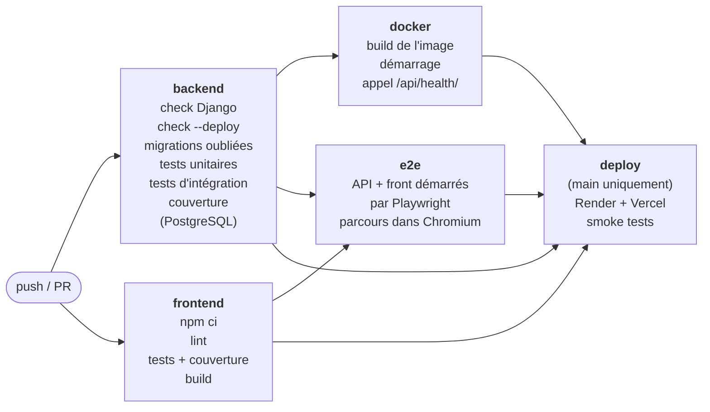
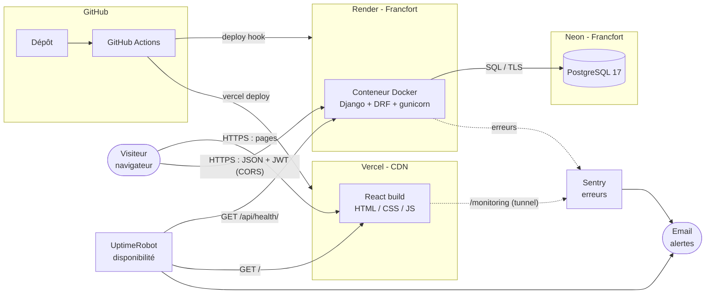

# Weeb — Dossier de retour d'expérience (REX) DevOps

**Projet** : Weeb, blog React + API Django
**Auteur** : Logan Donday (projet réalisé seul)
**Dépôt** : https://github.com/logandndy/weeb_Logan_donday

| | URL publique |
|---|---|
| Site | https://weeb-logan-donday.vercel.app |
| API | https://weeb-api-tjw9.onrender.com/api/ |
| État de l'API | https://weeb-api-tjw9.onrender.com/api/health/ |

Ce document explique comment l'application Weeb est passée d'un projet qui ne
tournait que sur mon poste à une application testée, déployée et surveillée
automatiquement, et pourquoi chaque choix a été fait. Le fonctionnement du code
lui-même (pages, endpoints, authentification) est décrit dans le
[README](../README.md).

## Sommaire

1. [Situation initiale](#1-situation-initiale)
2. [Stratégie DevOps](#2-stratégie-devops)
3. [Pipeline CI/CD](#3-pipeline-cicd)
4. [Containerisation](#4-containerisation)
5. [Déploiement](#5-déploiement)
6. [Architecture technique](#6-architecture-technique)
7. [Tests](#7-tests)
8. [Monitoring](#8-monitoring)
9. [Indicateurs de qualité](#9-indicateurs-de-qualité)
10. [Organisation du projet](#10-organisation-du-projet)
11. [Axes d'amélioration](#11-axes-damélioration)
12. [Retour d'expérience](#12-retour-dexpérience)

---

## 1. Situation initiale

### Fonctionnement de départ

À la fin de la semaine 2, Weeb fonctionnait, mais uniquement en local :

- un frontend React (Vite) lancé avec `npm run dev` sur le port 5173 ;
- une API Django REST lancée avec `python manage.py runserver` sur le port 8000 ;
- une base SQLite, c'est-à-dire un simple fichier `db.sqlite3` sur le disque.

Fonctionnellement, tout était là : inscription avec validation par un
administrateur, connexion JWT, CRUD des articles réservé à leur auteur,
formulaire de contact, réinitialisation du mot de passe.

### Limites et problèmes identifiés

En relisant le projet avec l'objectif « le mettre en ligne », j'ai relevé des
problèmes qui l'empêchaient d'être utilisé pour de vrai :

| Problème | Conséquence |
|---|---|
| `SECRET_KEY` écrite en dur dans `settings.py`, donc publique sur GitHub | N'importe qui pouvait signer de faux tokens JWT |
| `DEBUG = True` en permanence | En cas d'erreur, Django affiche le code et la configuration au visiteur |
| `ALLOWED_HOSTS` et CORS limités à `localhost` | L'API refuserait toute requête une fois en ligne |
| Base SQLite | Sur un hébergeur cloud le disque est éphémère : les données seraient effacées à chaque déploiement |
| Serveur `runserver` | Serveur de développement, mono-processus, pas prévu pour la production |
| Aucun test lancé automatiquement | Une régression pouvait passer inaperçue |
| Aucun déploiement | Le client ne pouvait pas voir le site |
| Aucune surveillance | Personne n'était prévenu si le site tombait |

Le problème de fond : **le projet dépendait de mon poste**. Une autre personne
qui clonait le dépôt n'avait aucune garantie de retrouver le même comportement,
et rien ne vérifiait que le code poussé fonctionnait.

---

## 2. Stratégie DevOps

### Principes retenus

1. **Même code partout, seule la configuration change** (principe des *12-Factor
   Apps*). Tout ce qui diffère entre mon poste et la production (secrets,
   domaines, base) est lu dans des variables d'environnement.
2. **Tout est décrit dans le dépôt** : pipeline (`ci.yml`), image (`Dockerfile`),
   infrastructure du backend (`render.yaml`), routage du front (`vercel.json`).
   Une configuration faite à la main dans un dashboard ne laisse aucune trace et
   ne peut pas être relue ; un fichier versionné, si.
3. **Les tests conditionnent la mise en ligne** : rien n'est déployé si un test
   échoue.
4. **Rester gratuit et sobre** : offres gratuites uniquement, ressources
   dimensionnées au besoin réel d'un blog.

### Outils retenus

| Besoin | Outil | Pourquoi celui-là | Alternative écartée |
|---|---|---|---|
| CI/CD | GitHub Actions | Déjà sur GitHub (imposé), gratuit, pipeline versionné dans le dépôt | GitLab CI, Jenkins : il aurait fallu un second outil ou un serveur à maintenir |
| Conteneur | Docker | Standard du marché, accepté directement par Render | — |
| Hébergement API | Render | Déploie un Dockerfile en offre gratuite, HTTPS fourni, région Francfort | Railway (plus vraiment gratuit), Fly.io (carte bancaire, tout en ligne de commande) |
| Base de données | Neon (PostgreSQL) | Gratuit sans limite de durée, région Francfort | Postgres de Render : la base gratuite expire après 30 jours |
| Hébergement front | Vercel | Conçu pour les applications Vite/React, CDN mondial, gratuit | Cloudflare Pages : équivalent, Vercel choisi pour sa CLI simple à appeler depuis le pipeline |
| Erreurs | Sentry | Remonte les erreurs back **et** front avec la pile d'appels, offre gratuite suffisante | Logs Render seuls : pas d'alerte, pas d'erreurs navigateur |
| Disponibilité | UptimeRobot | Sonde externe gratuite avec alerte mail | Health check de Render seul : il ne prévient personne |

On m'a demandé si quatre plateformes (GitHub, Render, Neon, Vercel) ne
compliquaient pas la maintenance. Mon raisonnement : chaque outil fait une seule
chose bien, et comme tout est décrit dans le dépôt, le nombre de services ne se
traduit pas par plus de configuration cachée.

---

## 3. Pipeline CI/CD

Fichier : [.github/workflows/ci.yml](../.github/workflows/ci.yml)

### Déclencheurs

- chaque **push** sur `main` ou `develop` ;
- chaque **Pull Request**.

Si je repousse sur une branche pendant qu'un pipeline tourne encore, l'ancien
est annulé (`concurrency: cancel-in-progress`) : inutile de consommer des
minutes de calcul pour un code déjà dépassé.

### Étapes



| Job | Étapes | Ce que ça garantit |
|---|---|---|
| `backend` | `manage.py check`, `check --deploy` en mode production, `makemigrations --check`, tests unitaires puis d'intégration + couverture, sur un vrai PostgreSQL | Configuration valide, **réglages de sécurité de production sans avertissement**, aucune migration oubliée, logique métier correcte sur la même base qu'en production |
| `frontend` | `npm ci`, lint, tests + couverture, build | Dépendances exactes du `package-lock.json`, code sans erreur de hooks, application qui compile |
| `docker` | Build de l'image, lancement du conteneur, attente d'un 200 sur `/api/health/` | L'image ne se contente pas de se construire : elle **démarre** et répond |
| `e2e` | Installation de Python, Node et Chromium, puis `npx playwright test` (Playwright démarre l'API et le front) ; rapport HTML conservé en cas d'échec | Les parcours utilisateur fonctionnent **de bout en bout**, front et API réunis |
| `deploy` | Déploiement Render, déploiement Vercel, smoke tests | La nouvelle version est réellement en ligne |

`backend` et `frontend` tournent **en parallèle** pour gagner du temps.
`docker` attend `backend` : inutile de construire l'image si les tests échouent.
`e2e` attend `backend` et `frontend` : les parcours complets sont les tests les
plus lents, on ne les lance que si chaque côté est déjà vert.

### Conditions de déploiement

```yaml
needs: [backend, frontend, docker, e2e]
if: github.event_name == 'push' && github.ref == 'refs/heads/main'
```

- `needs` : le déploiement ne démarre que si les quatre jobs sont verts.
- `if` : on ne déploie que sur un push sur `main`, jamais depuis une PR ni depuis
  `develop`. Sur une PR, le job `deploy` apparaît comme *skipped*.

Pour que **seul le pipeline** puisse déployer, j'ai désactivé le déploiement
automatique des deux hébergeurs (`autoDeployTrigger: "off"` dans `render.yaml`,
`"git": { "deploymentEnabled": false }` dans `vercel.json`). Sans ça, Render et
Vercel auraient déployé chaque commit dès sa réception, sans attendre les tests.

### Smoke tests

Après le déploiement, le pipeline interroge `/api/health/` toutes les 10 secondes
(15 minutes maximum) jusqu'à ce que l'API réponde avec **le SHA du commit qui
vient d'être poussé**. Vérifier un simple code 200 ne suffit pas : l'ancienne
version répond 200 aussi. Si la nouvelle version n'apparaît pas, le pipeline
passe au rouge. Un second test vérifie que le front répond.

### Secrets

`RENDER_DEPLOY_HOOK_URL`, `VERCEL_TOKEN`, `VERCEL_ORG_ID` et `VERCEL_PROJECT_ID`
sont stockés dans l'**environnement GitHub `production`**, restreint à la branche
`main`. Seul le job `deploy` y a accès (moindre privilège) et ils sont masqués
(`***`) dans les logs.

### Parcours d'une modification

```
branche feat/x ─► PR vers develop ─► CI (sans déploiement) ─► merge
develop ─► PR vers main ─► CI ─► merge
main ─► CI ─► deploy ─► smoke tests ─► version en ligne
```

Aucune action manuelle entre le merge sur `main` et la version en ligne.

---

## 4. Containerisation

### Ce qui est conteneurisé, et ce qui ne l'est pas

| Partie | Docker ? | Raison |
|---|---|---|
| API Django | ✅ | Elle a besoin d'un runtime Python, de dépendances système et d'un serveur qui tourne en permanence. L'image garantit le même environnement sur mon poste, dans la CI et sur Render |
| PostgreSQL en local | ✅ via `docker-compose.yml` | Une base identique à la production en une commande, jetable |
| PostgreSQL en production | ❌ | Service managé (Neon) : sauvegardes, mises à jour et disponibilité gérées par l'hébergeur. Faire tourner une base dans un conteneur gratuit éphémère aurait perdu les données |
| Frontend React | ❌ | Après `npm run build`, ce ne sont que des fichiers HTML, CSS et JS statiques. Un CDN (Vercel) les sert plus vite, près du visiteur, sans serveur allumé en permanence. Un conteneur Nginx n'apporterait que du coût et de la consommation |

### Choix dans le [Dockerfile](../backend/Dockerfile)

| Choix | Pourquoi |
|---|---|
| Image `python:3.13-slim` | Debian minimale : environ 293 Mo au final contre plus de 1 Go avec l'image complète. Moins de stockage, moins de transfert, moins de failles |
| `requirements.txt` copié et installé **avant** le code | Cache des couches : tant que les dépendances ne changent pas, Docker ne les réinstalle pas |
| `collectstatic` au build | Les fichiers de l'admin sont préparés une seule fois, pas à chaque démarrage |
| Utilisateur `appuser` non-root | Si l'application était compromise, l'attaquant n'aurait pas les droits root dans le conteneur |
| `HEALTHCHECK` sur `/api/health/` | Docker sait lui-même si l'API répond |
| `migrate` puis `gunicorn --workers 2` au démarrage | L'offre gratuite de Render n'a pas d'étape de pré-déploiement. 2 workers tiennent dans les 512 Mo de mémoire |

Le fichier `.dockerignore` exclut `venv/`, `db.sqlite3` et `.env` : des fichiers
lourds et inutiles, et surtout des secrets qui n'ont rien à faire dans une image.

`.gitattributes` force les fins de ligne LF pour le Dockerfile et les fichiers
YAML : je travaille sous Windows (CRLF) et un script Linux avec des CRLF échoue.

---

## 5. Déploiement

### Plateformes

| Composant | Plateforme | Région | Comment il est mis en ligne |
|---|---|---|---|
| API | Render (web service Docker, offre gratuite) | Francfort | Le pipeline appelle un *deploy hook* ; Render construit l'image depuis le `Dockerfile` |
| Base | Neon (PostgreSQL 17, offre gratuite) | Francfort | Service permanent ; l'API s'y connecte via `DATABASE_URL` |
| Front | Vercel (offre gratuite) | CDN mondial | Le pipeline lance `vercel deploy --prod` |

L'API et la base sont dans **la même région** : faible latence entre les deux,
et données hébergées dans l'Union européenne (RGPD).

### Infrastructure as Code

[render.yaml](../render.yaml) décrit le service Render : runtime Docker, région,
plan gratuit, chemin du health check, variables d'environnement. Les secrets n'y
figurent pas : `SECRET_KEY` est générée aléatoirement par Render
(`generateValue`), l'URL Neon et les URL du front sont saisies dans le dashboard
(`sync: false`).

Grâce au `healthCheckPath`, Render ne bascule le trafic vers la nouvelle version
que si elle répond correctement. Un déploiement raté ne coupe donc pas le site :
l'ancienne version reste en ligne.

Côté Vercel, la variable `VITE_API_URL` est **injectée au moment du build** : elle
est gravée dans le JavaScript. Changer sa valeur impose donc un nouveau
déploiement. [vercel.json](../frontend/vercel.json) redirige toutes les routes vers
`index.html`, sinon recharger `/blog/mon-article` renverrait une 404.

### Contraintes des offres gratuites

| Contrainte | Impact | Réponse apportée |
|---|---|---|
| Render met le service en veille après 15 min sans trafic | Première requête lente (~30 à 50 s, *cold start*) | Signalé dans le README ; la sonde UptimeRobot réveille l'API régulièrement (voir section 8) |
| Render : 512 Mo de mémoire, CPU partagé | Peu de marge | 2 workers gunicorn, image slim |
| Build Render lent (5 à 10 min) | Délai entre le merge et la mise en ligne | Le smoke test attend jusqu'à 15 min |
| Disque Render éphémère | Fichiers téléversés perdus au redéploiement | Les images d'articles sont des URL, pas des fichiers téléversés |
| Neon : 0,5 Go, calcul mis en pause hors usage | Quelques centaines de ms au réveil | Suffisant pour un blog |
| Pas d'étape de pré-déploiement sur Render gratuit | Les migrations ne peuvent pas tourner avant la bascule | Migrations lancées au démarrage du conteneur |
| Ports SMTP sortants bloqués sur Render gratuit | Impossible d'envoyer des emails en SMTP classique | Emails envoyés par l'API HTTP de Brevo (port 443) via `django-anymail` ; offre gratuite Brevo de 300 emails par jour |

---

## 6. Architecture technique



| Composant | Rôle | Interactions |
|---|---|---|
| **Navigateur** | Exécute l'application React | Télécharge les fichiers depuis Vercel, appelle l'API en direct avec le token JWT |
| **Vercel** | Sert les fichiers statiques du front | Fait aussi office de tunnel `/monitoring` vers Sentry, pour que les bloqueurs de publicité ne suppriment pas les rapports d'erreur |
| **Render** | Fait tourner l'API Django dans un conteneur | Reçoit les appels du front (CORS limité au domaine Vercel), lit et écrit dans Neon, envoie ses erreurs à Sentry |
| **Neon** | Stocke les données (utilisateurs, articles, messages) | Accessible uniquement par l'API, connexion chiffrée |
| **GitHub Actions** | Teste et déploie | Déclenché par chaque push, appelle Render et Vercel si tout est vert |
| **Sentry** | Centralise les erreurs back et front | Envoie un email à chaque nouvelle erreur |
| **UptimeRobot** | Vérifie de l'extérieur que l'API et le site répondent | Envoie un email si l'un des deux ne répond plus |

---

## 7. Tests

### Trois niveaux de tests

| Niveau | Outil | Question posée | Tests |
|---|---|---|---|
| **Unitaire** (backend) | Testeur Django, fichiers `test_unit.py`, tag `unit` | Cette brique, seule, fait-elle ce qu'on attend ? (modèle, sérialiseur, permission, envoi d'email) | 65 |
| **Intégration** (backend) | Testeur Django + client HTTP de DRF, fichiers `test_integration.py`, tag `integration` | Vue, sérialiseur, base, JWT et limitation de débit fonctionnent-ils ensemble, à travers de vraies requêtes HTTP ? | 64 |
| **Composants** (frontend) | Vitest + Testing Library | La couche `api.js`, la session et les écrans réagissent-ils correctement ? (API simulée) | 26 |
| **Bout en bout** (E2E) | Playwright + Chromium | Un utilisateur arrive-t-il au bout de ses parcours, front, API et base réunis ? | 9 parcours |

C'est une **pyramide** : beaucoup de tests unitaires (rapides, ils pointent
précisément la fonction cassée), moins de tests d'intégration, et quelques
tests E2E seulement, réservés aux parcours critiques. Un test E2E est le plus
convaincant, mais aussi le plus lent (navigateur, deux serveurs) et le plus
difficile à diagnostiquer quand il casse.

### Organisation

```
backend/weeb_api/tests/factories.py            utilitaires partagés
backend/apps/<app>/tests/test_unit.py          tests unitaires (tag "unit")
backend/apps/<app>/tests/test_integration.py   tests d'intégration (tag "integration")
frontend/src/**/*.test.js(x)                   tests Vitest, à côté du fichier testé
e2e/                                           tests Playwright (projet npm séparé)
```

- **`factories.py`** évite de répéter la création d'un utilisateur ou d'un
  article dans chaque fichier : `make_user`, `make_admin`, `make_article`,
  `auth_client` (connecte le client de test avec un **vrai token JWT**) et
  `ThrottleResetMixin` (remet à zéro les compteurs de limitation avant chaque test).
- Chaque classe porte un **tag** : `python manage.py test --tag unit` ne lance
  que les tests unitaires. En CI, les deux niveaux sont deux étapes distinctes.
- Le dossier **`e2e/` est à la racine**, pas dans `frontend/` : Vitest et
  ESLint du front y ramasseraient les fichiers Playwright.

Quelques pièges rencontrés, qui expliquent certains choix :

- `force_authenticate` (raccourci de DRF) **ne vérifie pas** que le compte est
  actif. Les tests « compte suspendu » utilisent donc un vrai token JWT, sinon
  ils passeraient même si la règle était cassée.
- Un ancien test (`test_refuse_non_admin_users`) **passait pour une mauvaise
  raison** : il créait un compte inactif, donc la requête était traitée comme
  anonyme et la règle « admin seulement » n'était jamais vérifiée. Il utilise
  maintenant un compte validé.
- L'horloge de Windows est peu précise : pour tester l'ordre « plus récent
  d'abord », les dates sont forcées en base. L'expiration d'un lien de
  réinitialisation se teste en changeant la durée de validité, sans attendre.

### Ce qui est testé côté backend (129 tests)

| Application | Unitaire | Intégration |
|---|---|---|
| `accounts` (34 + 26) | Création des comptes (inactif par défaut, mot de passe haché, email en minuscules, superutilisateur) ; validation de l'inscription (email déjà pris quelle que soit la casse, mots de passe faibles ou différents, champs obligatoires, mot de passe jamais renvoyé) ; lien de réinitialisation (uid illisible ou inconnu, token falsifié, **expiré**, **utilisable une seule fois**) ; contenu de l'email ; commande `seed_e2e` | Inscription ; connexion (compte non validé, mauvais mot de passe, email inconnu, **email en majuscules**, profil renvoyé) ; `/auth/me/` (sans token, **compte suspendu après la connexion**) ; renouvellement et vérification des tokens ; **parcours complet de réinitialisation** depuis le lien de l'email (nouveau mot de passe accepté, ancien refusé, lien rejoué refusé) ; limitation de débit (connexion, réinitialisation, inscription, un compteur par route) |
| `articles` (22 + 27) | Slug (accents, doublons `-2`/`-3`, titre sans lettre, slug stable quand le titre change) ; règles de validation (titre ≥ 5 et contenu ≥ 50 caractères hors espaces, URL d'image) ; champs gérés par le serveur non modifiables ; liste sans le contenu ; permission auteur / admin testée avec de faux objets | **Matrice des droits** ci-dessous ; auteur et slug envoyés par le client ignorés ; `PUT` incomplet refusé ; pagination (11 articles = 2 pages, page inexistante = 404) ; ordre du plus récent au plus ancien |
| `contact` (6 + 6) | Affichage dans l'admin ; non traité par défaut ; message ≥ 10 caractères ; email valide ; suivi interne jamais exposé | Message enregistré ; refus des messages trop courts et des emails invalides ; lecture des messages impossible (405) ; 11ᵉ message en une heure refusé (429) |
| `weeb_api` (3 + 5) | Route de santé : OK, version = commit déployé, **503 si la base ne répond plus** | Santé sans authentification ; route de test Sentry refusée aux visiteurs et aux utilisateurs non admin (session et JWT), active pour les admins |

Matrice des droits sur les articles, vérifiée profil par profil :

| Action | Visiteur | Auteur | Autre utilisateur | Admin |
|---|---|---|---|---|
| Voir un brouillon (liste et détail) | non (404) | oui | non (404) | oui |
| Créer un article | 401 | 201 | 201 | 201 |
| Modifier / supprimer | 401 | 200 / 204 | **403** | 200 / 204 |
| Agir avec un compte suspendu après la connexion | | 401 | 401 | |

### Ce qui est testé côté frontend (26 tests)

| Fichier | Ce qui est vérifié |
|---|---|
| `services/api.test.js` (7) | Token ajouté aux requêtes privées et pas aux routes publiques ; réponse 204 gérée ; token expiré renouvelé puis requête rejouée ; déconnexion si le renouvellement échoue ; erreurs Django converties en erreurs par champ ; message clair si le serveur est injoignable |
| `context/AuthContext.test.jsx` (5) | Pas d'appel à l'API sans token ; session restaurée au rechargement ; tokens effacés si le profil ne se charge pas ; `login()` et `logout()` |
| `components/ProtectedRoute.test.jsx` (3) | Un utilisateur connecté voit la page ; un visiteur est redirigé vers `/login` en mémorisant la page demandée ; la décision attend la vérification de la session |
| `components/Footer.test.jsx` (2) | Les liens de la maquette mènent aux vraies pages ; la newsletter confirme l'inscription sans recharger la page |
| `pages/Blog/ArticleForm.test.jsx` (2) | L'auteur retrouve son article pré-rempli ; un autre utilisateur voit un refus au lieu du formulaire |
| `pages/Blog/ArticleDetail.test.jsx` (4) | Boutons Modifier / Supprimer visibles pour l'auteur et pour un admin, masqués pour les autres et les visiteurs |
| `pages/Connexion/Login.test.jsx` (2) | Message clair sur un refus 401 ; redirection vers le blog après connexion |
| `pages/Contact/Contact.test.jsx` (1) | Remerciement et formulaire vidé après l'envoi |

### Tests de bout en bout (Playwright)

| Parcours | Ce qui est vérifié dans le navigateur |
|---|---|
| Visiteur | Ouvre un article depuis la liste du blog, sans boutons de modification ; ne voit pas le brouillon ; un brouillon ouvert par son adresse est introuvable ; `/blog/nouveau` renvoie vers la connexion |
| Inscription | Compte créé, message « doit être validé par un administrateur », puis connexion refusée |
| Publication | L'auteur connecté publie un article, qui s'affiche avec ses boutons et apparaît sur le blog |
| Modification et suppression | Formulaire pré-rempli, titre modifié sans changer l'adresse de l'article, suppression après confirmation |
| Contact | Message envoyé, remerciement affiché, formulaire vidé |
| Mot de passe oublié | Lien depuis la page de connexion, réponse neutre ; lien de réinitialisation incomplet signalé |

Choix de mise en œuvre :

- **Playwright démarre lui-même l'API et le front** (`webServer`), sur des ports
  dédiés (8001 et 5174) : rien à lancer à la main, et pas de conflit avec les
  serveurs de développement. J'ai d'ailleurs rencontré le cas : un autre
  programme occupait déjà le port 8000 de mon poste.
- **Base SQLite dédiée, recréée à chaque run** (`backend/e2e.sqlite3`), puis
  remplie par la commande `python manage.py seed_e2e` (un auteur validé, un
  compte en attente, un article publié, un brouillon). Chaque run part donc du
  même état, ce qui rend les tests reproductibles. La commande refuse de
  tourner hors mode `DEBUG` : elle crée des comptes au mot de passe connu.
- **Limitation de débit** : la connexion est limitée à 5 essais par minute. Un
  projet `setup` se connecte **une seule fois** par l'interface et mémorise la
  session (`storageState`), réutilisée par les parcours connectés. Les
  formulaires limités à l'heure (inscription, contact, mot de passe oublié)
  ne sont soumis qu'une fois par run, et le serveur redémarré remet les
  compteurs à zéro.
- Un seul navigateur à la fois (`workers: 1`) : les parcours partagent la même
  base. En CI, un test qui échoue est relancé une fois, et le rapport HTML
  (captures d'écran, traces) est conservé comme artefact pour comprendre l'échec.

Vérifié localement : 10 tests verts (9 parcours + la connexion préalable) sur
trois runs consécutifs, en 15 à 20 secondes.

### Bugs trouvés en écrivant les tests

| Bug | Correction |
|---|---|
| **Connexion sensible à la casse** : l'inscription enregistre l'email en minuscules, mais la connexion cherchait l'adresse exacte. `Ada@weeb.fr` ne pouvait pas se connecter | La recherche du compte à la connexion ignore la casse, et les emails sont enregistrés en minuscules dès la création |
| Boutons **Modifier / Supprimer cachés aux administrateurs** sur la page d'un article, alors que l'API et le formulaire les autorisent | Même règle partout : l'auteur ou un administrateur |
| Libellé **« Password \* »** en anglais sur la page de connexion | « Mot de passe \* » |

Chaque correction est couverte par un test qui échouait avant la correction.

### Pourquoi ces tests

J'ai testé en priorité **ce qui coûterait cher en cas de régression** :

- les **règles d'accès** (qui peut créer, modifier, supprimer) : une erreur serait
  une faille de sécurité ;
- le **parcours d'authentification** : sans lui, plus personne ne peut écrire ;
- la **couche `api.js`** côté front : tous les écrans passent par elle ;
- la **route de santé** : le déploiement et le monitoring s'appuient dessus ;
- les **parcours principaux de bout en bout** : ce sont eux que le client
  vérifie en premier, et seuls les E2E prouvent que front et API se
  comprennent (URL de l'API, CORS, format des réponses).

Les tests backend tournent dans la CI sur **PostgreSQL**, comme en production, et
non sur SQLite : certaines différences (contraintes, comparaisons de texte) ne se
voient qu'avec la vraie base.

### Intégration dans le pipeline

- tests unitaires puis tests d'intégration (deux étapes) dans le job `backend`,
  tests front dans le job `frontend` ;
- le job `e2e` attend que `backend` et `frontend` soient verts : inutile de
  lancer les tests les plus lents si une brique est déjà cassée ;
- un seul test en échec fait échouer son job, et donc bloque le job `deploy`
  (`needs`) : **la production garde l'ancienne version** ;
- le job `docker` est lui-même un test : l'image doit démarrer et répondre ;
- les smoke tests vérifient après coup que la bonne version est en ligne.

---

## 8. Monitoring

### Éléments surveillés

| Ce qui est surveillé | Outil | Pourquoi |
|---|---|---|
| Disponibilité de l'API **et** de la base | UptimeRobot sur `/api/health/` | La route fait un `SELECT 1` : une API qui répond sans base est quand même en panne. Elle renvoie 503 dans ce cas |
| Disponibilité du site | UptimeRobot sur la page d'accueil Vercel | Le front et l'API peuvent tomber indépendamment, chacun a sa sonde |
| Erreurs du backend (exceptions Python) | Sentry | Une erreur 500 est invisible pour moi si personne ne la signale |
| Erreurs du frontend (exceptions JavaScript) | Sentry | Elles se produisent dans le navigateur du visiteur, aucun log serveur ne les voit |
| Temps de réponse | Sentry (traces sur 10 % des requêtes) | Détecter une lenteur avant qu'elle ne devienne une panne |
| Version déployée | Champ `version` de `/api/health/` | Savoir quel commit tourne réellement en production |
| CPU, mémoire, logs | Dashboard Render | Vérifier que 512 Mo suffisent |

### Collecte

- **Sentry backend** : initialisé dans `settings.py` seulement si `SENTRY_DSN`
  est définie (rien n'est envoyé en local ni en CI). Chaque erreur est rattachée
  au commit déployé (`release`). `send_default_pii=False` : aucune adresse IP ni
  donnée personnelle n'est transmise (RGPD).
- **Sentry frontend** : initialisé dans `monitoring.js`. Les rapports passent par
  `/monitoring`, une réécriture Vercel vers Sentry : les bloqueurs de publicité
  bloquent les domaines Sentry, mais pas le domaine du site.
- **UptimeRobot** : deux sondes HTTP externes toutes les 5 minutes, une sur `/api/health/`, une sur le site Vercel.
- Une route `/api/debug-sentry/`, réservée aux administrateurs, déclenche une
  erreur volontaire pour vérifier que la chaîne fonctionne.

### Visualisation

- **Sentry** : liste des erreurs regroupées, nombre d'occurrences, pile d'appels,
  navigateur, commit concerné ; onglet *Performance* pour les temps de réponse.
- **UptimeRobot** : pourcentage de disponibilité et historique des incidents.
- **Render** : graphiques CPU et mémoire, logs en direct.
- **GitHub Actions** : historique des pipelines, durée et résultat de chaque job.

**UptimeRobot** : les deux sondes sont vertes, 100 % de disponibilité depuis
leur mise en place (plus de 14 jours sans incident).


**Sentry, vue des projets** : un projet par partie de l'application, 0 erreur
sur la période.


**Sentry, projet `weeb-api`** : 100 % de sessions sans crash sur 14 jours,
erreurs rattachées aux versions déployées (`ced88f2`, `fdcb2e8`, les SHA des
commits de `main`).


### Alertes

| Déclencheur | Canal |
|---|---|
| `/api/health/` ou le site ne répond pas, ou renvoie une erreur (503) | Email UptimeRobot |
| Nouvelle erreur détectée par Sentry | Email Sentry |
| Pipeline en échec | Email GitHub |
| Déploiement Render en échec | Email Render |

### Utilisation des ressources et impact énergétique

Un serveur allumé consomme de l'énergie qu'il serve des visiteurs ou non. Mes
choix visent à **ne faire tourner que ce qui est utile** :

| Choix | Effet |
|---|---|
| Front en fichiers statiques sur CDN, sans conteneur | Aucun serveur dédié allumé en permanence pour le front ; les fichiers sont mis en cache près du visiteur |
| Image Docker `slim` (~293 Mo au lieu de >1 Go) | Moins de stockage et de transfert à chaque build et déploiement |
| 2 workers gunicorn | Dimensionné pour le trafic d'un blog, pas pour un pic imaginaire |
| Cache pip et npm dans la CI | Les dépendances ne sont pas retéléchargées à chaque pipeline |
| `cancel-in-progress` | Un pipeline devenu inutile est arrêté au lieu d'aller au bout |
| `docker` attend `backend`, `deploy` attend tout | On ne construit et ne déploie rien qui sera rejeté |
| Sentry sur 10 % des requêtes | Assez pour voir les tendances, sans envoyer chaque requête |
| Veille Render et pause Neon hors trafic | Rien ne tourne quand personne ne visite |

**Le compromis à assumer** : la sonde UptimeRobot interroge l'API toutes les 5
minutes, ce qui l'empêche de se mettre en veille. J'échange un peu de
consommation contre deux bénéfices : être prévenu d'une panne et éviter le
démarrage à froid de 30 à 50 secondes aux visiteurs. Pour un vrai client, ce
choix se discute : un blog peu visité pourrait accepter le *cold start* et
espacer la sonde.

Je n'ai pas de mesure chiffrée de la consommation : les hébergeurs gratuits
n'exposent pas cette donnée. Les leviers ci-dessus restent ceux sur lesquels j'ai
la main.

---

## 9. Indicateurs de qualité

| Indicateur | Valeur actuelle | Où le lire | Pourquoi il compte |
|---|---|---|---|
| Tests backend | 129 (65 unitaires + 64 d'intégration), tous verts | Job `backend` | Filet de sécurité contre les régressions |
| Tests frontend | 26, tous verts | Job `frontend` | Idem côté interface |
| Parcours E2E | 9 parcours (+ 1 connexion), tous verts | Job `e2e` | Preuve que l'application fonctionne pour un utilisateur réel, front et API réunis |
| Couverture backend | 93 % | `coverage report` dans la CI | Part du code de l'application exécutée par les tests (dossiers `tests/` et `migrations/` exclus). Ce n'est pas une garantie de qualité, mais une couverture basse signale du code jamais vérifié |
| Couverture frontend | ~79 % des lignes mesurées | `npm run test:coverage` | Mesurée sur `services/`, `components/` et `context/`. Les pages ont quelques tests ciblés et sont surtout couvertes par les parcours E2E (~52 % si on mesure tout `src/`) |
| Taux de réussite du pipeline | Les 15 derniers runs verts | Onglet *Actions* | Un pipeline souvent rouge signale du code poussé sans être vérifié |
| Durée du pipeline jusqu'à la mise en ligne | ~5 à 10 min (surtout le build Render) | Onglet *Actions* | Délai pour livrer un correctif |
| Disponibilité de l'API et du site | 100 % sur 14 jours | Dashboard UptimeRobot | Ce que le client perçoit en premier |
| Sessions sans crash (API) | 100 % | Sentry, projet `weeb-api` | Part des utilisations qui se terminent sans erreur |
| Nombre d'erreurs en production | 0 sur 14 jours (back et front) | Dashboard Sentry | Mesure directe des bugs subis par les visiteurs |
| Temps de réponse de l'API | Traces Sentry | Sentry *Performance* | Une API lente dégrade l'expérience avant même de tomber |
| Lint frontend | 0 erreur, 0 warning | Job `frontend` | Code homogène, erreurs de hooks détectées avant l'exécution |
| Taille de l'image Docker | ~293 Mo | `docker images` | Ressources et temps de déploiement |

Ces indicateurs couvrent trois angles : **la qualité du code avant livraison**
(tests, couverture, lint), **la fiabilité de la livraison** (taux de réussite,
durée du pipeline) et **le comportement en production** (disponibilité, erreurs,
temps de réponse).

---

## 10. Organisation du projet

### Planification

J'ai réalisé le projet **seul**. J'ai donc assuré toutes les tâches : front,
back, DevOps, tests, documentation. Pour éviter de m'éparpiller, j'ai découpé la
semaine 3 en étapes courtes, chacune livrée par sa propre branche et validée par
la CI avant de passer à la suivante, dans un ordre où chaque étape s'appuie sur
la précédente :

| Étape | Livrable | Dépend de |
|---|---|---|
| 1. Configuration de production | Variables d'environnement, route `/api/health/` | — |
| 2. Docker | `Dockerfile`, `docker-compose.yml` | 1 |
| 3. CI | Tests back, lint et build front, build Docker | 2 |
| 4. Déploiement | Render, Neon, Vercel, `render.yaml` | 1, 2 |
| 5. CD | Déploiement conditionné aux tests, smoke tests | 3, 4 |
| 6. Tests frontend | Vitest dans la CI | 3 |
| 7. Monitoring | Sentry back et front, UptimeRobot, alertes | 4 |
| 8. Documentation | README, REX | Tout |

### Évolution dans le temps

| Période | Travail |
|---|---|
| Semaine 1 (mars 2026) | Pages vitrine React : Home, Contact, Login, animations |
| Semaine 2 (juillet - août 2026) | API Django (auth JWT, articles, contact), séparation `frontend/` et `backend/`, branchement du front sur l'API |
| Semaine 3 (26 - 27 septembre 2026) | Étapes 1 à 7 : configuration, Docker, CI, déploiement, CD, tests front, Sentry |
| 12 octobre 2026 | Audit complet du projet par rapport aux critères des trois semaines, mise à jour du README, rédaction de ce REX ; tests réorganisés en trois niveaux (unitaires, intégration, E2E Playwright) et job `e2e` dans la CI |

### Workflow Git

`main` (production) ← `develop` (intégration) ← `feat/*`, `fix/*`, `docs/*`.

Chaque fonctionnalité passe par une branche, une Pull Request vers `develop` (CI
lancée), puis une PR de `develop` vers `main` qui déclenche le déploiement. Les
branches sont supprimées après le merge. Les commits suivent les *Conventional
Commits* (`feat:`, `fix:`, `ci:`, `test:`, `docs:`).

Ce workflow n'a pas été appliqué parfaitement, et je préfère le dire :

- les premiers commits de la semaine 1 (« Premier commit », « terminé ») ne
  suivent pas de convention ; je l'ai adoptée à partir de la semaine 2 ;
- deux PR (#6 et #7) ont été ouvertes par erreur vers `main` au lieu de
  `develop` ;
- le correctif `fix/sentry` a été fusionné en local puis poussé, sans PR ;
- les premières PR n'étaient pas reliées à des issues.

Depuis l'audit, chaque changement part d'une issue et la PR la référence
(`Closes #n`).

---

## 11. Axes d'amélioration

| Amélioration | Pourquoi |
|---|---|
| **Protéger la branche `main`** (PR obligatoire, CI verte requise) | Rendre impossible le contournement du workflow, comme pour `fix/sentry` |
| **Seuil de couverture minimal** dans la CI | Aujourd'hui la couverture est affichée mais une baisse ne fait pas échouer le pipeline |
| **Limitation du nombre de requêtes par IP réelle** | Le throttling compte par IP, mais derrière le proxy de Render l'IP est lue dans l'en-tête `X-Forwarded-For`, qu'un client peut falsifier. Le compteur est aussi propre à chaque worker gunicorn (cache en mémoire) ; un cache partagé (Redis) le rendrait exact |
| **Environnement de préproduction** | Tester sur une copie de la prod avant de livrer |
| **Validation humaine avant la prod** (*required reviewers* sur l'environnement GitHub) | Un dernier regard avant chaque mise en ligne |
| **Scan de sécurité des dépendances** (Dependabot) | Être prévenu des failles connues dans les bibliothèques |
| **Révocation des tokens JWT** à la déconnexion | Un token de rafraîchissement volé reste valable 7 jours |
| **Mesure de l'empreinte** (par exemple avec un outil comme Green Metrics Tool sur la CI) | Passer d'une réflexion qualitative à des chiffres |

---

## 12. Retour d'expérience

### Connaissances acquises

- **Séparer le code de la configuration** : c'est ce qui permet au même code de
  tourner sur mon poste, dans la CI et en production.
- **Docker** : la différence entre image et conteneur, le cache des couches,
  pourquoi ne pas tourner en root, et surtout *quand ne pas* conteneuriser.
- **CI/CD** : un pipeline n'est pas qu'une suite de commandes, c'est une chaîne
  de conditions (`needs`, `if`) qui décide si le code a le droit d'aller en
  production.
- **Vérifier plutôt que supposer** : un déploiement « réussi » ne prouve pas que
  la bonne version tourne, d'où le smoke test sur le SHA.
- **Monitoring** : collecter des erreurs ne sert à rien sans alerte ; une sonde
  externe voit des pannes que l'application elle-même ne peut pas signaler.

### Difficultés rencontrées

| Problème | Cause | Solution et leçon |
|---|---|---|
| Scripts cassés dans le conteneur et la CI | Fins de ligne Windows (CRLF) | `.gitattributes` qui force LF |
| Le front en ligne obtenait des 404 de l'API | `VITE_API_URL` sans `/api`, et la variable est gravée au build | Corrigée puis redéploiement. Leçon : une variable Vite n'est pas lue à l'exécution |
| Health check OK mais données perdues | `DATABASE_URL` absente sur Render, Django retombait sur SQLite | Variable ajoutée, et vérification en créant un compte via l'API puis en le retrouvant dans Neon. Leçon : un « ok » ne prouve pas tout |
| `Scheme '://' is unknown` au démarrage | Texte d'exemple collé à la place de l'URL Neon | La configuration échoue franchement au démarrage plutôt que de tourner de travers |
| Port 8000 déjà occupé en local | Un autre projet Docker tournait | Port configurable (`BACKEND_PORT`) |
| Erreurs du front jamais reçues par Sentry | Les bloqueurs de publicité bloquent les domaines Sentry | Tunnel `/monitoring` via une réécriture Vercel |
| Render et Vercel déployaient sans attendre les tests | Déploiement automatique activé par défaut | Désactivé des deux côtés, le pipeline orchestre tout |

### Choix réalisés

Les choix les plus structurants, et ce qu'ils m'ont coûté :

- **Backend conteneurisé, front non** : bonne reproductibilité de l'API, et le
  front profite du CDN. Coût : deux modes de déploiement différents à maintenir.
- **Base managée (Neon) plutôt qu'une base dans un conteneur** : données
  persistantes et sauvegardées sans effort. Coût : un service de plus.
- **Déploiement piloté par GitHub Actions** plutôt que par les hébergeurs : les
  tests conditionnent vraiment la mise en ligne. Coût : des secrets à gérer dans
  GitHub.
- **Offres gratuites uniquement** : aucun coût pour le client. Coût : mise en
  veille, builds lents, et un contournement pour les emails (API Brevo au lieu
  du SMTP bloqué par Render).
- **Sécurisé par défaut** : depuis l'audit, `DEBUG` vaut `False` si rien n'est
  précisé, et la CI vérifie la configuration de production
  (`check --deploy --fail-level WARNING`). Coût : il faut un fichier `.env`
  pour développer en local.

### Limites de la solution

- Pas d'environnement de préproduction : ce qui est mergé sur `main` part
  directement en production.
- Démarrage à froid de Render si la sonde de disponibilité est arrêtée.
- Limitation du nombre de requêtes approximative : compteur par worker, IP
  lue dans un en-tête falsifiable.
- Une ancienne `SECRET_KEY` de développement reste visible dans l'historique Git.
  Elle n'est utilisée nulle part : la production utilise une clé générée par
  Render.
- Un seul développeur : pas de relecture de code par une autre personne, la CI
  est le seul relecteur.

Le projet répond au besoin de Weeb : chaque modification est testée et déployée
sans intervention manuelle, l'application est accessible publiquement, et je
suis prévenu en cas de panne ou d'erreur. Les limites ci-dessus sont connues et
chiffrées dans les axes d'amélioration.
