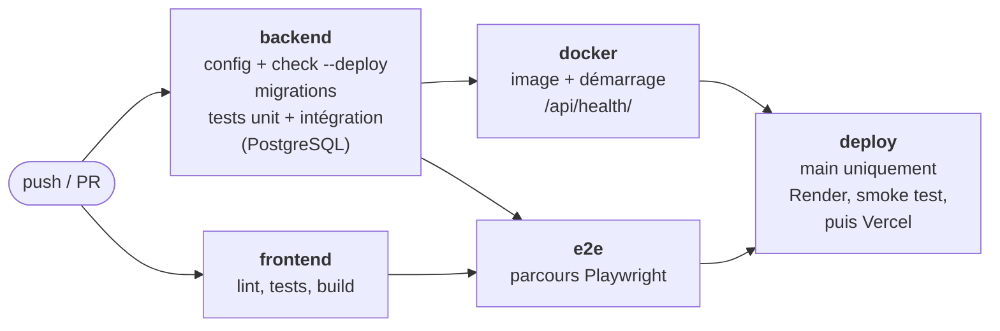
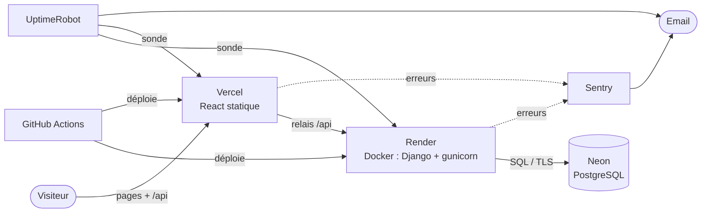
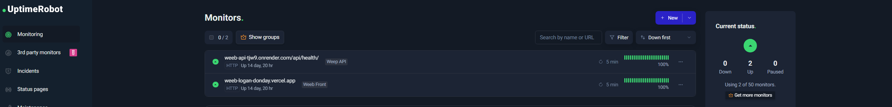
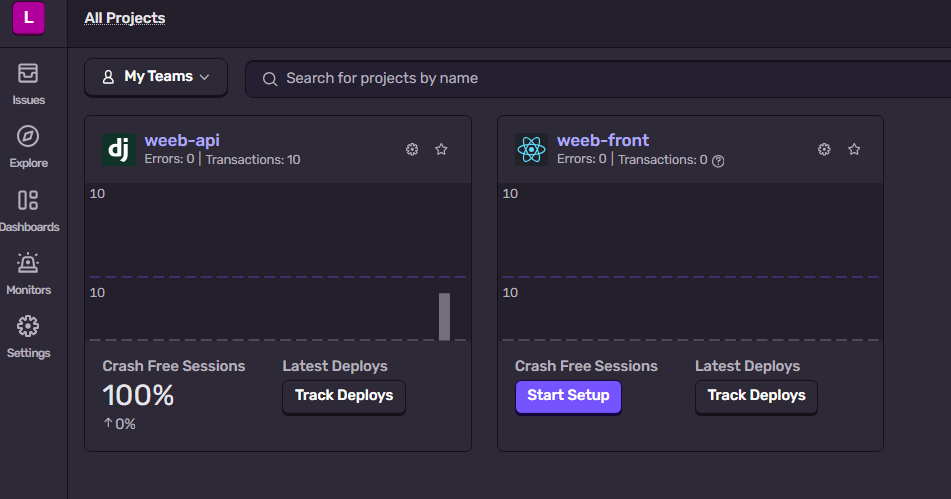
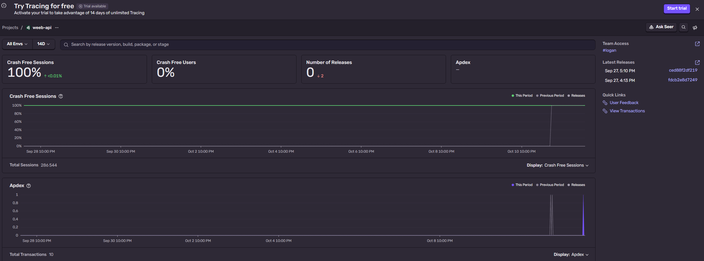

# Weeb — Retour d'expérience (REX) DevOps

**Projet** : Weeb, blog React + API Django · **Auteur** : Logan Donday (seul) ·
**Dépôt** : https://github.com/logandndy/weeb_Logan_donday

| | URL publique |
|---|---|
| Site | https://weeb-logan-donday.vercel.app |
| API / santé | https://weeb-api-tjw9.onrender.com/api/health/ |

**En une phrase** : chaque modification poussée sur `main` est testée, déployée
et vérifiée en ligne sans intervention manuelle, et je suis prévenu par email si
le site tombe ou plante. Le fonctionnement du code est décrit dans le
[README](../README.md).

1. [Situation initiale](#1-situation-initiale) · 2. [Stratégie](#2-stratégie-devops) ·
3. [Pipeline CI/CD](#3-pipeline-cicd) · 4. [Containerisation](#4-containerisation) ·
5. [Déploiement](#5-déploiement) · 6. [Architecture](#6-architecture-technique) ·
7. [Tests](#7-tests) · 8. [Monitoring](#8-monitoring) ·
9. [Indicateurs](#9-indicateurs-de-qualité) · 10. [Organisation](#10-organisation-du-projet) ·
11. [Améliorations](#11-axes-damélioration) · 12. [Retour d'expérience](#12-retour-dexpérience)

---

## 1. Situation initiale

Fin semaine 2, Weeb fonctionnait **uniquement sur mon poste** : `npm run dev`,
`runserver` et une base SQLite. Tout était là côté fonctionnalités, mais rien
n'était prêt pour une utilisation réelle :

| Problème | Conséquence |
|---|---|
| `SECRET_KEY` écrite dans le code, donc publique sur GitHub | N'importe qui pouvait signer de faux tokens JWT |
| `DEBUG = True` en permanence | Le code et la config s'affichent au visiteur en cas d'erreur |
| Base SQLite | Disque éphémère en cloud : données effacées à chaque déploiement |
| Serveur `runserver` | Outil de développement, pas fait pour la production |
| Aucun test automatique, aucun déploiement, aucune surveillance | Régressions invisibles, site inaccessible, pannes ignorées |

Le vrai problème : **le projet dépendait de mon poste**, et rien ne vérifiait
que le code poussé fonctionnait.

---

## 2. Stratégie DevOps

Quatre principes :

1. **Même code partout, seule la configuration change** : les secrets et réglages viennent de variables d'environnement.
2. **Tout est décrit dans le dépôt** (`ci.yml`, `Dockerfile`, `render.yaml`, `vercel.json`) : relisible et reproductible, contrairement à des clics dans un dashboard.
3. **Les tests décident de la mise en ligne.**
4. **Gratuit et sobre** : offres gratuites, ressources dimensionnées pour un blog.

| Besoin | Outil retenu | Pourquoi | Écarté |
|---|---|---|---|
| CI/CD | GitHub Actions | Déjà sur GitHub, gratuit, pipeline versionné | Jenkins, GitLab CI : un outil de plus à maintenir |
| API | Render | Déploie un Dockerfile gratuitement, HTTPS fourni | Railway (plus gratuit), Fly.io (carte bancaire) |
| Base | Neon (PostgreSQL) | Gratuit sans limite de durée | Postgres Render : expire après 30 jours |
| Front | Vercel | Fait pour Vite/React, CDN mondial | Cloudflare Pages : équivalent |
| Erreurs | Sentry | Erreurs back **et** navigateur, avec la pile d'appels | Logs Render seuls : pas d'alerte |
| Disponibilité | UptimeRobot | Sonde externe gratuite + alerte mail | Health check Render : ne prévient personne |

Quatre plateformes, mais aucune configuration cachée : tout est dans le dépôt.

---

## 3. Pipeline CI/CD

Fichier : [.github/workflows/ci.yml](../.github/workflows/ci.yml). Déclenché à
chaque **push** sur `main`/`develop` et à chaque **Pull Request**.



| Job | Ce qu'il garantit |
|---|---|
| `backend` | Config valide, sécurité de prod sans avertissement, aucune migration oubliée, 173 tests verts sur un vrai PostgreSQL |
| `frontend` | Code propre (lint), 49 tests verts, application qui compile |
| `docker` | L'image se construit **et démarre** |
| `e2e` | Les parcours utilisateur marchent, front + API réunis |
| `deploy` | La nouvelle version est réellement en ligne |

**Logique d'enchaînement**

- `backend` et `frontend` en **parallèle** pour gagner du temps ; les jobs lents (`docker`, `e2e`) ne partent que si les tests rapides sont verts.
- `deploy` : `needs: [backend, frontend, docker, e2e]` + `if: push sur main`. Un seul échec = **la production garde l'ancienne version**.
- Seul le pipeline déploie : déploiement automatique **désactivé** chez Render (`autoDeployTrigger: "off"`) et Vercel (`deploymentEnabled: false`). Sinon ils déploieraient sans attendre les tests.
- **Smoke test** : le pipeline attend que `/api/health/` renvoie **le SHA du commit poussé**. Un simple 200 ne suffit pas, l'ancienne version répond 200 aussi.
- **L'API d'abord, le front ensuite** : le front n'est mis en ligne que si la nouvelle API répond. Un dernier test vérifie que le site relaie bien `/api`.
- **Droits minimum** (`permissions: contents: read`) et **version de la CLI Vercel épinglée** : une mise à jour extérieure ne peut pas casser le déploiement par surprise.
- **Dependabot** ([dependabot.yml](../.github/dependabot.yml)) ouvre chaque semaine une PR par dépendance à mettre à jour (pip, npm, image Docker, actions). La CI la teste comme les autres.
- **Versions fixées** : Python 3.13 ([.python-version](../.python-version)) et Node 24 ([.nvmrc](../.nvmrc)), lues par la CI. Le poste de dev, la CI et l'image Docker utilisent les mêmes.
- **Secrets** (hook Render, token Vercel) dans l'environnement GitHub `production`, lisibles par le seul job `deploy`, masqués dans les logs.
- `cancel-in-progress` : un nouveau push annule le pipeline précédent devenu inutile.

```
feat/x ─PR─> develop (CI) ─PR─> main (CI) ─> deploy ─> smoke test ─> en ligne
```

---

## 4. Containerisation

| Partie | Docker ? | Raison |
|---|---|---|
| API Django | ✅ | Runtime Python + dépendances + serveur permanent : la même image tourne sur mon poste, en CI et sur Render |
| PostgreSQL local | ✅ (`docker-compose.yml`) | Base identique à la prod en une commande |
| PostgreSQL prod | ❌ | Service managé (Neon) : sauvegardes et maintenance incluses ; un conteneur gratuit perdrait les données |
| Front React | ❌ | Après le build, ce sont des fichiers statiques : un CDN les sert mieux qu'un serveur allumé en permanence |

Choix du [Dockerfile](../backend/Dockerfile) :

| Choix | Pourquoi |
|---|---|
| `python:3.13-slim` | ~293 Mo au lieu de >1 Go : moins de stockage, de transfert et de failles |
| Dépendances installées **avant** le code | Cache Docker : pas de réinstallation si `requirements.txt` ne change pas |
| Utilisateur non-root | Une faille ne donne pas les droits root du conteneur |
| `HEALTHCHECK` sur `/api/ping/` | Docker sait si l'API répond, sans réveiller la base toutes les 30 s |
| `migrate`, nettoyage, puis `exec gunicorn --workers 2` | Pas d'étape pré-déploiement en gratuit. Le nettoyage (messages de plus de 12 mois, tokens expirés) tourne à chaque démarrage, faute de tâche planifiée en gratuit. `exec` : gunicorn reçoit lui-même le signal d'arrêt et termine proprement. 2 workers tiennent dans 512 Mo |

`.dockerignore` exclut `venv/`, la base locale et `.env` (secrets).
`.gitattributes` force les fins de ligne LF : sous Windows, des CRLF cassent les scripts Linux.

---

## 5. Déploiement

| Composant | Plateforme | Mise en ligne |
|---|---|---|
| API | Render, Francfort | Le pipeline appelle un *deploy hook*, Render construit l'image |
| Base | Neon, Francfort | Service permanent, l'API s'y connecte via `DATABASE_URL` |
| Front | Vercel, CDN | Le pipeline lance `vercel deploy --prod` |

- API et base dans **la même région** : faible latence, données dans l'UE (RGPD).
- [render.yaml](../render.yaml) décrit le service (*Infrastructure as Code*). `SECRET_KEY` est générée par Render, les autres secrets saisis dans le dashboard : aucun dans Git.
- Render ne bascule le trafic que si la nouvelle version passe son health check : **un déploiement raté ne coupe pas le site**.
- Le front appelle **`/api` sur son propre domaine**, Vercel relaie vers Render ([vercel.json](../frontend/vercel.json)). Aucune adresse d'API n'est gravée au build, et CORS n'est plus nécessaire. Le cache de Vercel est désactivé sur `/api` : une réponse qui pose un cookie de session ne doit jamais être servie à quelqu'un d'autre.

| Contrainte de l'offre gratuite | Réponse |
|---|---|
| Veille après 15 min sans trafic (~30-50 s au réveil) | Sonde UptimeRobot sur `/api/ping/` toutes les 10 min |
| 512 Mo de mémoire | Image slim, 2 workers |
| Build lent (5-10 min) | Le smoke test attend jusqu'à 15 min |
| Disque éphémère | Images d'articles stockées en URL, pas en fichiers |
| Ports SMTP bloqués | Emails via l'API HTTP de Brevo (port 443), 300/jour |
| Neon : 0,5 Go | Largement suffisant pour un blog |
| Neon : 100 h de calcul par mois | Seules les vraies requêtes et une sonde horaire réveillent la base (voir §8) |

---

## 6. Architecture technique



| Composant | Rôle |
|---|---|
| **Vercel** | Sert le front et ses en-têtes de sécurité (CSP). Relaie `/api` vers Render et `/monitoring` vers Sentry : le navigateur ne parle qu'à un seul domaine |
| **Render** | Fait tourner l'API |
| **Neon** | Stocke utilisateurs, articles et messages. Accessible seulement par l'API |
| **GitHub Actions** | Teste puis déploie |
| **Sentry / UptimeRobot** | Erreurs et disponibilité, avec alerte email |

---

## 7. Tests

**Trois niveaux, en pyramide** : beaucoup de tests rapides et précis, peu de
tests lents mais réalistes.

| Niveau | Outil | Question posée | Tests |
|---|---|---|---|
| Unitaire | Django (`test_unit.py`) | Cette brique seule fonctionne-t-elle ? (modèle, validation, permission, email) | 79 |
| Intégration | Django + client HTTP (`test_integration.py`) | Vue, base, JWT et limites fonctionnent-ils ensemble ? | 94 |
| Front | Vitest + Testing Library | `api.js`, session et écrans réagissent-ils bien ? | 49 |
| Bout en bout | Playwright (Chromium) | Un utilisateur arrive-t-il au bout de son parcours ? | 12 parcours |

**Ce que j'ai testé en priorité** : ce qui coûterait cher si ça cassait.

- **Les droits d'accès**, profil par profil :

| Action sur un article | Visiteur | Auteur | Autre utilisateur | Admin |
|---|---|---|---|---|
| Voir un brouillon | 404 | oui | 404 | oui |
| Créer | 401 | 201 | 201 | 201 |
| Modifier / supprimer | 401 | oui | **403** | oui |

- **L'authentification** : compte non validé refusé, compte suspendu après connexion refusé, parcours complet de réinitialisation (lien à usage unique, expiré), limitation des requêtes.
- **Les parcours E2E** : visiteur qui lit le blog, inscription, publication / modification / suppression d'un article, contact, mot de passe oublié, session (rechargement, token illisible par le JavaScript, déconnexion).

**Choix de mise en œuvre**

- Les tests portent un **tag** (`unit`, `integration`) : la CI les lance en deux étapes.
- Un fichier [factories.py](../backend/weeb_api/tests/factories.py) évite de répéter la création d'utilisateurs et d'articles.
- Les tests backend tournent en CI sur **PostgreSQL**, comme en production.
- **E2E** : Playwright démarre lui-même l'API et le front, sur une base **recréée à chaque run** (résultats reproductibles). La connexion est faite une seule fois puis réutilisée, à cause de la limite de 5 connexions par minute. Comme le cookie change à chaque renouvellement, chaque test enregistre la session pour le suivant ([session.js](../e2e/tests/session.js)).

**Ce que les tests m'ont appris**

- Un ancien test **passait pour une mauvaise raison** : il utilisait un compte inactif, donc la règle « admin seulement » n'était jamais vérifiée.
- Le raccourci `force_authenticate` de DRF **ignore** si le compte est validé : les tests de compte suspendu utilisent donc un vrai token JWT.
- **Un vrai bug trouvé** : la connexion était sensible à la casse de l'email. Corrigé, avec un test qui échouait avant.
- **Un autre en relisant SimpleJWT** : renouveler la session d'un compte supprimé provoquait une erreur 500 au lieu d'un 401. Corrigé et testé.

---

## 8. Monitoring

| Surveillé | Outil | Pourquoi |
|---|---|---|
| API disponible | UptimeRobot sur `/api/ping/` (10 min) | Réponse sans toucher la base ; garde aussi Render éveillé |
| Base disponible | UptimeRobot sur `/api/health/` (1 h) | La route teste la base : une API sans base est en panne (503) |
| Site disponible | UptimeRobot sur Vercel (5 min) | Front et API peuvent tomber séparément |
| Erreurs back et front | Sentry | Une erreur 500 ou JavaScript est invisible sinon |
| Temps de réponse | Sentry (10 % des requêtes) | Voir une lenteur avant la panne |
| Version en ligne | `/api/health/` → `version` | Savoir quel commit tourne |
| CPU, mémoire | Dashboard Render | Vérifier que 512 Mo suffisent |

**Journaux** : une configuration `LOGGING` envoie les avertissements et les
erreurs vers la sortie standard, donc dans les logs Render. Sans elle, Django
n'écrivait les erreurs 500 qu'en mode debug.

**Collecte** : Sentry n'est actif qu'en production (variable `SENTRY_DSN`),
chaque erreur est rattachée au commit déployé, **sans données personnelles**
(RGPD). Côté front, les rapports passent par `/monitoring` sur le domaine du
site, pour ne pas être bloqués par les bloqueurs de pub.

**Alertes** (toutes par email) : site ou API injoignable (UptimeRobot), nouvelle
erreur (Sentry), pipeline en échec (GitHub), déploiement raté (Render).

**Visualisation** : 100 % de disponibilité sur 14 jours, 0 erreur, 100 % de
sessions sans crash.





> Les ~286 000 sessions Sentry de l'API viennent surtout des sondes (UptimeRobot, Render), pas de visiteurs.

**Ressources et énergie** : un serveur allumé consomme, qu'il serve quelqu'un ou non. Principe : ne faire tourner que l'utile.

| Choix | Effet |
|---|---|
| Front statique sur CDN, sans conteneur | Aucun serveur dédié allumé pour le front |
| Image slim, 2 workers | Taille et mémoire ajustées au besoin réel |
| Cache pip/npm, `cancel-in-progress`, jobs conditionnés | Pas de calcul inutile en CI |
| Sentry sur 10 % des requêtes | Tendances visibles sans tout envoyer |
| Veille Render et Neon | Rien ne tourne sans visiteur |

**Incident du 19 octobre : quota Neon dépassé.** Mon premier réglage
appelait `/api/health/` (qui interroge la base) partout : health check Render
toutes les quelques secondes, Docker toutes les 30 s, UptimeRobot toutes les
5 min. Neon ne se met en veille qu'après 5 min sans activité : la base n'a donc
jamais dormi. Elle a tourné ~440 h en 23 jours, soit ~110 h de calcul pour un
quota gratuit de 100 h, et Neon a coupé les connexions. Le site est resté
affiché (Vercel) mais l'API ne répondait plus.

**Correction** : deux routes aux rôles séparés.

| Route | Touche la base ? | Appelée par | Fréquence |
|---|---|---|---|
| `/api/ping/` | Non | Health check Render, Docker, UptimeRobot | secondes / 30 s / 10 min |
| `/api/health/` | Oui | Smoke test du pipeline, UptimeRobot | à chaque déploiement / 1 h |

Les connexions à la base sont aussi fermées après chaque requête
(`conn_max_age=0`) pour qu'une connexion inactive ne retienne pas Neon. Estimation :
~5 min de réveil par heure, soit ~60 h d'allumage et ~15 h de calcul par mois,
plus les visites réelles. Render reste éveillé (744 h par mois pour 750 h
gratuites).

**Leçon** : la réflexion énergie était juste sur le principe (« ne faire tourner
que l'utile »), mais je n'avais pas mesuré ce que coûtait chaque sonde. Une route
de surveillance doit être aussi légère que possible, et la consommation des
offres gratuites se vérifie dans leurs tableaux de bord, pas seulement en théorie.

---

## 9. Indicateurs de qualité

| Angle | Indicateur | Valeur | Pourquoi |
|---|---|---|---|
| Avant livraison | Tests back / front / E2E | 173 / 49 / 12 parcours, tous verts | Filet contre les régressions |
| | Couverture back | 95 % (hors tests et migrations) | Code jamais exécuté = code jamais vérifié |
| | Couverture front | ~78 % (services, composants, session) | Les pages sont surtout couvertes par l'E2E |
| | Lint front | 0 erreur | Code homogène |
| Livraison | Réussite du pipeline | 15 derniers runs verts | Stabilité du code livré |
| | Durée jusqu'à la mise en ligne | 5 à 10 min | Vitesse pour livrer un correctif |
| Production | Disponibilité | 100 % sur 14 jours | Ce que le client voit en premier |
| | Erreurs / sessions sans crash | 0 / 100 % | Bugs réellement subis |
| | Taille de l'image | ~293 Mo | Ressources et temps de déploiement |

---

## 10. Organisation du projet

Projet réalisé **seul** : front, back, DevOps, tests et documentation. La
semaine 3 est découpée en étapes courtes, une branche chacune, validée par la CI
avant la suivante.

| Période | Travail |
|---|---|
| Semaine 1 (mars 2026) | Pages vitrine React : Home, Contact, Login |
| Semaine 2 (juillet - août) | API Django, séparation front/back, branchement du front |
| Semaine 3 (26 - 27 sept.) | Config de prod → Docker → CI → déploiement → CD → tests front → Sentry |
| 12 octobre | Audit des 3 semaines, alertes, sécurité back, nettoyage front, tests en 3 niveaux, documentation |
| 23 octobre | Retour de l'école : site 100 % français, versions fixées, inscription neutre, session en cookie HttpOnly, durcissement |

**Git** : `main` (production) ← `develop` ← `feat/*`, `fix/*`, `docs/*`, commits
*Conventional Commits*. Écarts assumés : premiers commits sans convention, PR
#6 et #7 ouvertes vers `main` par erreur, `fix/sentry` fusionné sans PR, et des
issues pas toujours créées. D'où l'axe d'amélioration « protéger `main` ».

---

## 11. Axes d'amélioration

| Amélioration | Pourquoi |
|---|---|
| Protéger `main` (PR + CI obligatoires) | Rendre le workflow impossible à contourner |
| Seuil de couverture minimal en CI | Une baisse de couverture ne bloque rien aujourd'hui |
| Régler `NUM_PROXIES` d'après les logs de production | Lire la vraie IP du visiteur derrière Vercel et Render, qu'il ne peut pas falsifier |
| N'accepter que le trafic venant de Vercel (secret partagé) | Aujourd'hui, l'adresse Render reste joignable en direct |
| Environnement de préproduction + validation humaine | Tester sur une copie de la prod avant de livrer |
| Mesure de l'empreinte de la CI | Passer d'une réflexion qualitative à des chiffres |

---

## 12. Retour d'expérience

**Ce que j'ai appris**

- Séparer code et configuration : c'est ce qui permet au même code de tourner partout.
- Docker : image vs conteneur, cache des couches, non-root, et surtout *quand ne pas* conteneuriser.
- Un pipeline est une chaîne de **conditions** (`needs`, `if`) qui décide si le code a le droit d'aller en production.
- **Vérifier plutôt que supposer** : un déploiement « réussi » ne prouve pas que la bonne version tourne.
- Collecter des erreurs ne sert à rien sans alerte.

**Difficultés**

| Problème | Leçon |
|---|---|
| Scripts cassés en CI (fins de ligne Windows) | `.gitattributes` force LF |
| Front en ligne → 404 sur l'API | `VITE_API_URL` est lue au build, pas à l'exécution |
| Base coupée : quota Neon dépassé par les sondes | Une sonde fréquente ne doit pas toucher la base (`/api/ping/`) |
| Health check OK mais données sur SQLite (variable `DATABASE_URL` absente) | Un « ok » ne prouve pas tout : vérifier dans la vraie base |
| Erreurs du front jamais reçues par Sentry | Les bloqueurs de pub : relais `/monitoring` |
| Render et Vercel déployaient sans attendre les tests | Désactiver leur déploiement automatique |
| Revue de l'école : cookie `SameSite=Lax` demandé, mais `vercel.app` et `onrender.com` sont deux sites différents | Faire passer l'API par le domaine du front : le cookie devient interne au site |

**Choix et leur coût**

| Choix | Gain | Coût |
|---|---|---|
| API en Docker, front sur CDN | Reproductibilité + rapidité | Deux modes de déploiement |
| Base managée (Neon) | Données sauvegardées sans effort | Un service de plus |
| Déploiement piloté par GitHub Actions | Les tests décident vraiment | Secrets à gérer dans GitHub |
| Offres gratuites | Aucun coût | Veille, builds lents, SMTP bloqué |
| Sécurisé par défaut (`DEBUG=False`) | Un oubli ne crée pas de faille | Un `.env` nécessaire en local |
| API relayée par Vercel, session en cookie HttpOnly | Token hors de portée d'un XSS, plus de CORS | Un intermédiaire de plus entre le visiteur et l'API |

**Limites** : pas de préproduction ; IP du visiteur à régler (`NUM_PROXIES`) ;
une ancienne clé de dev reste dans l'historique Git (jamais utilisée en prod) ;
seul développeur, donc la CI est le seul relecteur.
