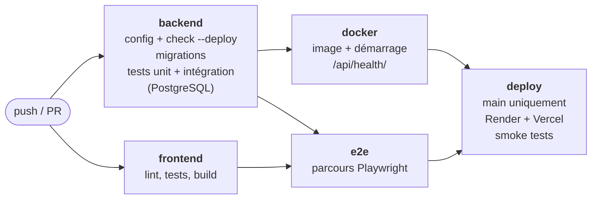
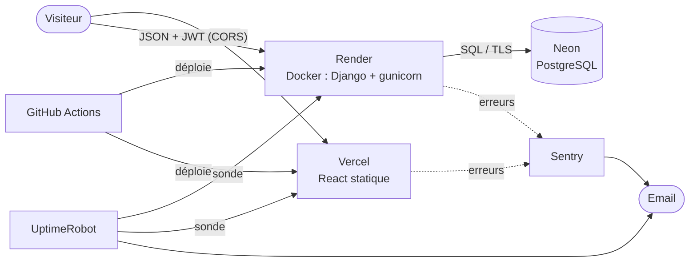
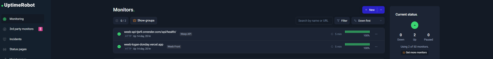
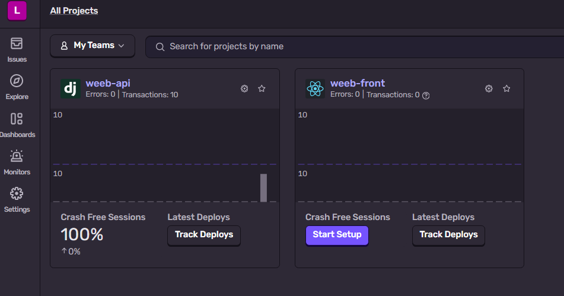
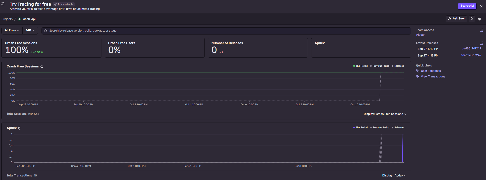

# Weeb — Retour d'expérience (REX) DevOps

**Projet** : Weeb, blog React + API Django · **Auteur** : Logan Donday (seul) ·
**Dépôt** : https://github.com/logandndy/weeb_Logan_donday

| | URL publique |
|---|---|
| Site | https://weeb-logan-donday.vercel.app |
| API / santé | https://weeb-api-tjw9.onrender.com/api/health/ |

**En une phrase** : chaque modification poussée sur `main` est testée, déployée
et vérifiée en ligne sans intervention manuelle, et je suis prévenu par email si
le site tombe ou plante. Le fonctionnement du code est décrit dans le
[README](../README.md).

1. [Situation initiale](#1-situation-initiale) · 2. [Stratégie](#2-stratégie-devops) ·
3. [Pipeline CI/CD](#3-pipeline-cicd) · 4. [Containerisation](#4-containerisation) ·
5. [Déploiement](#5-déploiement) · 6. [Architecture](#6-architecture-technique) ·
7. [Tests](#7-tests) · 8. [Monitoring](#8-monitoring) ·
9. [Indicateurs](#9-indicateurs-de-qualité) · 10. [Organisation](#10-organisation-du-projet) ·
11. [Améliorations](#11-axes-damélioration) · 12. [Retour d'expérience](#12-retour-dexpérience)

---

## 1. Situation initiale

Fin semaine 2, Weeb fonctionnait **uniquement sur mon poste** : `npm run dev`,
`runserver` et une base SQLite. Tout était là côté fonctionnalités, mais rien
n'était prêt pour une utilisation réelle :

| Problème | Conséquence |
|---|---|
| `SECRET_KEY` écrite dans le code, donc publique sur GitHub | N'importe qui pouvait signer de faux tokens JWT |
| `DEBUG = True` en permanence | Le code et la config s'affichent au visiteur en cas d'erreur |
| Base SQLite | Disque éphémère en cloud : données effacées à chaque déploiement |
| Serveur `runserver` | Outil de développement, pas fait pour la production |
| Aucun test automatique, aucun déploiement, aucune surveillance | Régressions invisibles, site inaccessible, pannes ignorées |

Le vrai problème : **le projet dépendait de mon poste**, et rien ne vérifiait
que le code poussé fonctionnait.

---

## 2. Stratégie DevOps

Quatre principes :

1. **Même code partout, seule la configuration change** : les secrets et réglages viennent de variables d'environnement.
2. **Tout est décrit dans le dépôt** (`ci.yml`, `Dockerfile`, `render.yaml`, `vercel.json`) : relisible et reproductible, contrairement à des clics dans un dashboard.
3. **Les tests décident de la mise en ligne.**
4. **Gratuit et sobre** : offres gratuites, ressources dimensionnées pour un blog.

| Besoin | Outil retenu | Pourquoi | Écarté |
|---|---|---|---|
| CI/CD | GitHub Actions | Déjà sur GitHub, gratuit, pipeline versionné | Jenkins, GitLab CI : un outil de plus à maintenir |
| API | Render | Déploie un Dockerfile gratuitement, HTTPS fourni | Railway (plus gratuit), Fly.io (carte bancaire) |
| Base | Neon (PostgreSQL) | Gratuit sans limite de durée | Postgres Render : expire après 30 jours |
| Front | Vercel | Fait pour Vite/React, CDN mondial | Cloudflare Pages : équivalent |
| Erreurs | Sentry | Erreurs back **et** navigateur, avec la pile d'appels | Logs Render seuls : pas d'alerte |
| Disponibilité | UptimeRobot | Sonde externe gratuite + alerte mail | Health check Render : ne prévient personne |

Quatre plateformes, mais aucune configuration cachée : tout est dans le dépôt.

---

## 3. Pipeline CI/CD

Fichier : [.github/workflows/ci.yml](../.github/workflows/ci.yml). Déclenché à
chaque **push** sur `main`/`develop` et à chaque **Pull Request**.



| Job | Ce qu'il garantit |
|---|---|
| `backend` | Config valide, sécurité de prod sans avertissement, aucune migration oubliée, 129 tests verts sur un vrai PostgreSQL |
| `frontend` | Code propre (lint), 26 tests verts, application qui compile |
| `docker` | L'image se construit **et démarre** |
| `e2e` | Les parcours utilisateur marchent, front + API réunis |
| `deploy` | La nouvelle version est réellement en ligne |

**Logique d'enchaînement**

- `backend` et `frontend` en **parallèle** pour gagner du temps ; les jobs lents (`docker`, `e2e`) ne partent que si les tests rapides sont verts.
- `deploy` : `needs: [backend, frontend, docker, e2e]` + `if: push sur main`. Un seul échec = **la production garde l'ancienne version**.
- Seul le pipeline déploie : déploiement automatique **désactivé** chez Render (`autoDeployTrigger: "off"`) et Vercel (`deploymentEnabled: false`). Sinon ils déploieraient sans attendre les tests.
- **Smoke test** : le pipeline attend que `/api/health/` renvoie **le SHA du commit poussé**. Un simple 200 ne suffit pas, l'ancienne version répond 200 aussi.
- **Secrets** (hook Render, token Vercel) dans l'environnement GitHub `production`, lisibles par le seul job `deploy`, masqués dans les logs.
- `cancel-in-progress` : un nouveau push annule le pipeline précédent devenu inutile.

```
feat/x ─PR─> develop (CI) ─PR─> main (CI) ─> deploy ─> smoke test ─> en ligne
```

---

## 4. Containerisation

| Partie | Docker ? | Raison |
|---|---|---|
| API Django | ✅ | Runtime Python + dépendances + serveur permanent : la même image tourne sur mon poste, en CI et sur Render |
| PostgreSQL local | ✅ (`docker-compose.yml`) | Base identique à la prod en une commande |
| PostgreSQL prod | ❌ | Service managé (Neon) : sauvegardes et maintenance incluses ; un conteneur gratuit perdrait les données |
| Front React | ❌ | Après le build, ce sont des fichiers statiques : un CDN les sert mieux qu'un serveur allumé en permanence |

Choix du [Dockerfile](../backend/Dockerfile) :

| Choix | Pourquoi |
|---|---|
| `python:3.13-slim` | ~293 Mo au lieu de >1 Go : moins de stockage, de transfert et de failles |
| Dépendances installées **avant** le code | Cache Docker : pas de réinstallation si `requirements.txt` ne change pas |
| Utilisateur non-root | Une faille ne donne pas les droits root du conteneur |
| `HEALTHCHECK` sur `/api/health/` | Docker sait si l'API répond |
| `migrate` puis `gunicorn --workers 2` | Pas d'étape pré-déploiement en gratuit ; 2 workers tiennent dans 512 Mo |

`.dockerignore` exclut `venv/`, la base locale et `.env` (secrets).
`.gitattributes` force les fins de ligne LF : sous Windows, des CRLF cassent les scripts Linux.

---

## 5. Déploiement

| Composant | Plateforme | Mise en ligne |
|---|---|---|
| API | Render, Francfort | Le pipeline appelle un *deploy hook*, Render construit l'image |
| Base | Neon, Francfort | Service permanent, l'API s'y connecte via `DATABASE_URL` |
| Front | Vercel, CDN | Le pipeline lance `vercel deploy --prod` |

- API et base dans **la même région** : faible latence, données dans l'UE (RGPD).
- [render.yaml](../render.yaml) décrit le service (*Infrastructure as Code*). `SECRET_KEY` est générée par Render, les autres secrets saisis dans le dashboard : aucun dans Git.
- Render ne bascule le trafic que si la nouvelle version passe son health check : **un déploiement raté ne coupe pas le site**.
- `VITE_API_URL` est **gravée au build** du front : la changer impose un redéploiement.

| Contrainte de l'offre gratuite | Réponse |
|---|---|
| Veille après 15 min sans trafic (~30-50 s au réveil) | La sonde UptimeRobot garde l'API éveillée |
| 512 Mo de mémoire | Image slim, 2 workers |
| Build lent (5-10 min) | Le smoke test attend jusqu'à 15 min |
| Disque éphémère | Images d'articles stockées en URL, pas en fichiers |
| Ports SMTP bloqués | Emails via l'API HTTP de Brevo (port 443), 300/jour |
| Neon : 0,5 Go | Largement suffisant pour un blog |

---

## 6. Architecture technique



| Composant | Rôle |
|---|---|
| **Vercel** | Sert le front. Sert aussi de relais `/monitoring` vers Sentry, pour passer les bloqueurs de pub |
| **Render** | Fait tourner l'API. N'accepte que les appels venant du domaine Vercel (CORS) |
| **Neon** | Stocke utilisateurs, articles et messages. Accessible seulement par l'API |
| **GitHub Actions** | Teste puis déploie |
| **Sentry / UptimeRobot** | Erreurs et disponibilité, avec alerte email |

---

## 7. Tests

**Trois niveaux, en pyramide** : beaucoup de tests rapides et précis, peu de
tests lents mais réalistes.

| Niveau | Outil | Question posée | Tests |
|---|---|---|---|
| Unitaire | Django (`test_unit.py`) | Cette brique seule fonctionne-t-elle ? (modèle, validation, permission, email) | 65 |
| Intégration | Django + client HTTP (`test_integration.py`) | Vue, base, JWT et limites fonctionnent-ils ensemble ? | 64 |
| Front | Vitest + Testing Library | `api.js`, session et écrans réagissent-ils bien ? | 26 |
| Bout en bout | Playwright (Chromium) | Un utilisateur arrive-t-il au bout de son parcours ? | 9 parcours |

**Ce que j'ai testé en priorité** : ce qui coûterait cher si ça cassait.

- **Les droits d'accès**, profil par profil :

| Action sur un article | Visiteur | Auteur | Autre utilisateur | Admin |
|---|---|---|---|---|
| Voir un brouillon | 404 | oui | 404 | oui |
| Créer | 401 | 201 | 201 | 201 |
| Modifier / supprimer | 401 | oui | **403** | oui |

- **L'authentification** : compte non validé refusé, compte suspendu après connexion refusé, parcours complet de réinitialisation (lien à usage unique, expiré), limitation des requêtes.
- **Les parcours E2E** : visiteur qui lit le blog, inscription, publication / modification / suppression d'un article, contact, mot de passe oublié.

**Choix de mise en œuvre**

- Les tests portent un **tag** (`unit`, `integration`) : la CI les lance en deux étapes.
- Un fichier [factories.py](../backend/weeb_api/tests/factories.py) évite de répéter la création d'utilisateurs et d'articles.
- Les tests backend tournent en CI sur **PostgreSQL**, comme en production.
- **E2E** : Playwright démarre lui-même l'API et le front, sur une base **recréée à chaque run** (résultats reproductibles). La connexion est faite une seule fois puis réutilisée, à cause de la limite de 5 connexions par minute.

**Ce que les tests m'ont appris**

- Un ancien test **passait pour une mauvaise raison** : il utilisait un compte inactif, donc la règle « admin seulement » n'était jamais vérifiée.
- Le raccourci `force_authenticate` de DRF **ignore** si le compte est validé : les tests de compte suspendu utilisent donc un vrai token JWT.
- **Un vrai bug trouvé** : la connexion était sensible à la casse de l'email. Corrigé, avec un test qui échouait avant.

---

## 8. Monitoring

| Surveillé | Outil | Pourquoi |
|---|---|---|
| API **et** base disponibles | UptimeRobot sur `/api/health/` (5 min) | La route teste la base : une API sans base est en panne (503) |
| Site disponible | UptimeRobot sur Vercel (5 min) | Front et API peuvent tomber séparément |
| Erreurs back et front | Sentry | Une erreur 500 ou JavaScript est invisible sinon |
| Temps de réponse | Sentry (10 % des requêtes) | Voir une lenteur avant la panne |
| Version en ligne | `/api/health/` → `version` | Savoir quel commit tourne |
| CPU, mémoire | Dashboard Render | Vérifier que 512 Mo suffisent |

**Collecte** : Sentry n'est actif qu'en production (variable `SENTRY_DSN`),
chaque erreur est rattachée au commit déployé, **sans données personnelles**
(RGPD). Côté front, les rapports passent par `/monitoring` sur le domaine du
site, pour ne pas être bloqués par les bloqueurs de pub.

**Alertes** (toutes par email) : site ou API injoignable (UptimeRobot), nouvelle
erreur (Sentry), pipeline en échec (GitHub), déploiement raté (Render).

**Visualisation** : 100 % de disponibilité sur 14 jours, 0 erreur, 100 % de
sessions sans crash.





> Les ~286 000 sessions Sentry de l'API viennent surtout des sondes (UptimeRobot, Render), pas de visiteurs.

**Ressources et énergie** : un serveur allumé consomme, qu'il serve quelqu'un ou non. Principe : ne faire tourner que l'utile.

| Choix | Effet |
|---|---|
| Front statique sur CDN, sans conteneur | Aucun serveur dédié allumé pour le front |
| Image slim, 2 workers | Taille et mémoire ajustées au besoin réel |
| Cache pip/npm, `cancel-in-progress`, jobs conditionnés | Pas de calcul inutile en CI |
| Sentry sur 10 % des requêtes | Tendances visibles sans tout envoyer |
| Veille Render et Neon | Rien ne tourne sans visiteur |

**Compromis assumé** : la sonde toutes les 5 min empêche la mise en veille.
Un peu plus de consommation, contre une alerte en cas de panne et pas de
démarrage lent pour les visiteurs. Pas de mesure chiffrée possible : les offres
gratuites n'exposent pas la consommation.

---

## 9. Indicateurs de qualité

| Angle | Indicateur | Valeur | Pourquoi |
|---|---|---|---|
| Avant livraison | Tests back / front / E2E | 129 / 26 / 9 parcours, tous verts | Filet contre les régressions |
| | Couverture back | 93 % (hors tests et migrations) | Code jamais exécuté = code jamais vérifié |
| | Couverture front | ~79 % (services, composants, session) | Les pages sont surtout couvertes par l'E2E |
| | Lint front | 0 erreur | Code homogène |
| Livraison | Réussite du pipeline | 15 derniers runs verts | Stabilité du code livré |
| | Durée jusqu'à la mise en ligne | 5 à 10 min | Vitesse pour livrer un correctif |
| Production | Disponibilité | 100 % sur 14 jours | Ce que le client voit en premier |
| | Erreurs / sessions sans crash | 0 / 100 % | Bugs réellement subis |
| | Taille de l'image | ~293 Mo | Ressources et temps de déploiement |

---

## 10. Organisation du projet

Projet réalisé **seul** : front, back, DevOps, tests et documentation. La
semaine 3 est découpée en étapes courtes, une branche chacune, validée par la CI
avant la suivante.

| Période | Travail |
|---|---|
| Semaine 1 (mars 2026) | Pages vitrine React : Home, Contact, Login |
| Semaine 2 (juillet - août) | API Django, séparation front/back, branchement du front |
| Semaine 3 (26 - 27 sept.) | Config de prod → Docker → CI → déploiement → CD → tests front → Sentry |
| 12 octobre | Audit des 3 semaines, alertes, sécurité back, nettoyage front, tests en 3 niveaux, documentation |

**Git** : `main` (production) ← `develop` ← `feat/*`, `fix/*`, `docs/*`, commits
*Conventional Commits*. Écarts assumés : premiers commits sans convention, PR
#6 et #7 ouvertes vers `main` par erreur, `fix/sentry` fusionné sans PR, et des
issues pas toujours créées. D'où l'axe d'amélioration « protéger `main` ».

---

## 11. Axes d'amélioration

| Amélioration | Pourquoi |
|---|---|
| Protéger `main` (PR + CI obligatoires) | Rendre le workflow impossible à contourner |
| Seuil de couverture minimal en CI | Une baisse de couverture ne bloque rien aujourd'hui |
| Limitation des requêtes via Redis et vraie IP | Le compteur actuel est par worker, et l'IP lue peut être falsifiée |
| Environnement de préproduction + validation humaine | Tester sur une copie de la prod avant de livrer |
| Dependabot | Être prévenu des failles dans les dépendances |
| Révocation des tokens à la déconnexion | Un token volé reste valable 7 jours |
| Mesure de l'empreinte de la CI | Passer d'une réflexion qualitative à des chiffres |

---

## 12. Retour d'expérience

**Ce que j'ai appris**

- Séparer code et configuration : c'est ce qui permet au même code de tourner partout.
- Docker : image vs conteneur, cache des couches, non-root, et surtout *quand ne pas* conteneuriser.
- Un pipeline est une chaîne de **conditions** (`needs`, `if`) qui décide si le code a le droit d'aller en production.
- **Vérifier plutôt que supposer** : un déploiement « réussi » ne prouve pas que la bonne version tourne.
- Collecter des erreurs ne sert à rien sans alerte.

**Difficultés**

| Problème | Leçon |
|---|---|
| Scripts cassés en CI (fins de ligne Windows) | `.gitattributes` force LF |
| Front en ligne → 404 sur l'API | `VITE_API_URL` est lue au build, pas à l'exécution |
| Health check OK mais données sur SQLite (variable `DATABASE_URL` absente) | Un « ok » ne prouve pas tout : vérifier dans la vraie base |
| Erreurs du front jamais reçues par Sentry | Les bloqueurs de pub : relais `/monitoring` |
| Render et Vercel déployaient sans attendre les tests | Désactiver leur déploiement automatique |

**Choix et leur coût**

| Choix | Gain | Coût |
|---|---|---|
| API en Docker, front sur CDN | Reproductibilité + rapidité | Deux modes de déploiement |
| Base managée (Neon) | Données sauvegardées sans effort | Un service de plus |
| Déploiement piloté par GitHub Actions | Les tests décident vraiment | Secrets à gérer dans GitHub |
| Offres gratuites | Aucun coût | Veille, builds lents, SMTP bloqué |
| Sécurisé par défaut (`DEBUG=False`) | Un oubli ne crée pas de faille | Un `.env` nécessaire en local |

**Limites** : pas de préproduction ; limitation des requêtes approximative ;
une ancienne clé de dev reste dans l'historique Git (jamais utilisée en prod) ;
seul développeur, donc la CI est le seul relecteur.
